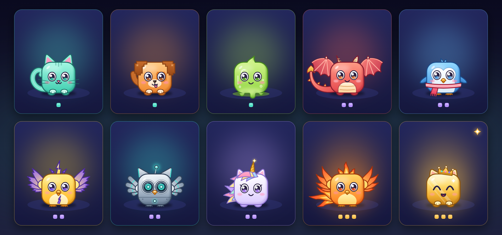
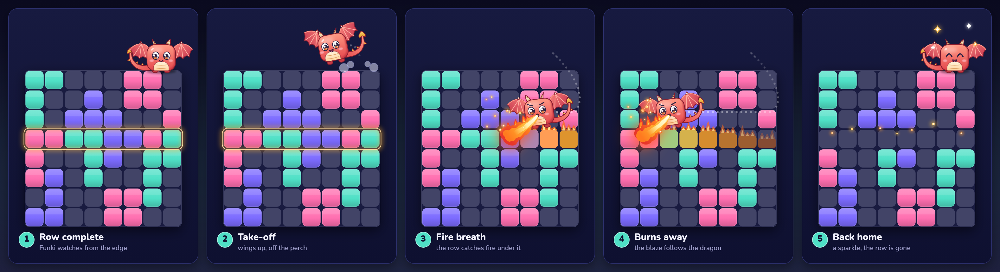
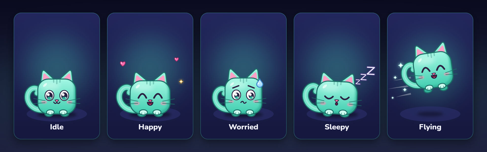
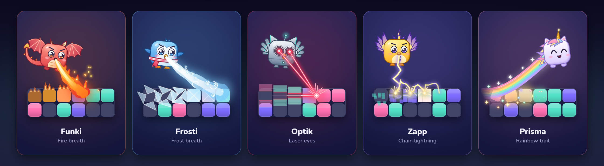
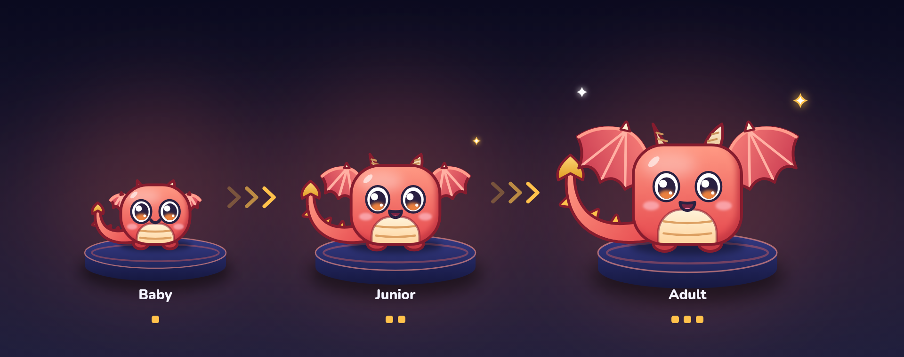
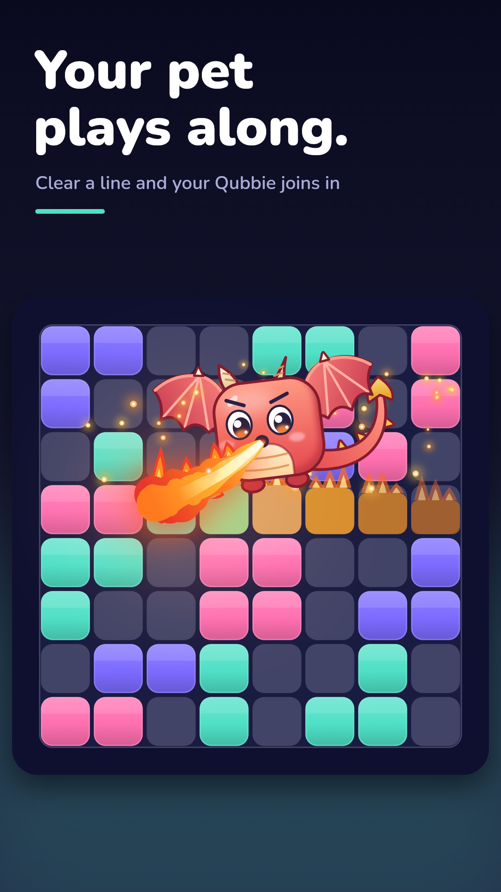
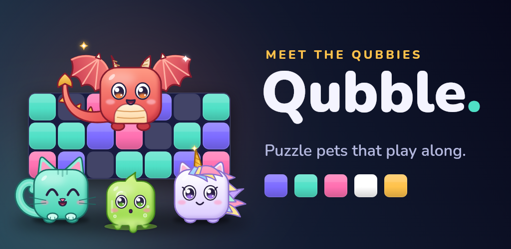
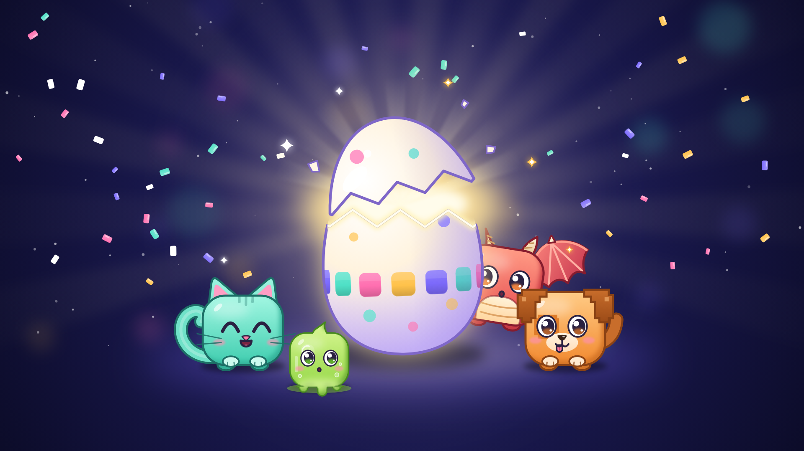

# Haustiere („Qubbies") — das Konzept

Stand 13.10.2026 · Auftrag des Nutzers vom 12./13.10.2026 · **Konzept, nichts
davon ist gebaut** (außer den Konzeptbildern in `docs/haustiere/`, erzeugt von
`tool/pet_concept.dart`). Die Entscheidungen, die vor dem Bau fallen müssen,
und die Bau-Reihenfolge stehen als Checkliste in `MASTERPLAN.md` Phase 8.
Dieses Dokument ist das Nachschlagewerk dazu: was, warum, mit welchen Zahlen
und Belegen.

Der Auftrag, wörtlich:

> Großes Ziel ist es, dass die Haustiere neue Nutzer locken. Außerdem soll es
> den Spielspaß erhöhen, und neue Möglichkeiten, dass Nutzer potentiell wieder
> Geld ausgeben können bzw. Werbung gucken. Und dass das Tier dann „mitspielt"
> und vielleicht rumfliegt, wenn man eine Reihe löst, und visuelle Effekte
> auslöst. Die Haustiere sollten auch recht teuer sein, teurer als Designs. Und
> das wird dann auch gut beworben, dass Nutzer schnell sehen, dass es
> Haustiere hier gibt. Also Store-Assets etc. Evtl. auch Event planen für den
> Release.

---

## 0 · Kurzfassung

- **Zehn Qubbies** — Würfelwesen im Stil der Blöcke: drei Starter, fünf
  Premium, ein legendäres, ein Gründer-Qubbie nur zum Start.
- **Es spielt mit:** Das Qubbie sitzt auf der Brettkante, schaut deinem Stück
  nach, und wenn eine Reihe voll ist, **fliegt es die Reihe entlang und löst
  sie mit seinem Effekt auf** — der Drache mit Feuer, der Pinguin mit Frost,
  die Robo-Eule mit Laseraugen.
- **Teurer als Designs:** Ein Starter ist gratis, die übrigen kosten
  **300 / 600 / 900 / 1.500 💎** — das Zwei- bis Zehnfache des teuersten
  Designs heute (150 💎); Goldi nur in den Schlüpf-Wochen für 1.200 💎 oder
  im Gründer-Paket.
- **Neue Einnahmen:** zwei Kaufangebote (Qubbie-Starterangebot, Gründer-Paket
  nur zum Start), zwei freiwillige Videos (Snack, sofort schlüpfen), Futter als
  Gold-Senke.
- **Fair:** kein Qubbie gibt Punkte, Züge oder Hinweise; ein gekauftes Qubbie
  ist nie stärker als ein Starter; keine Zufalls-Eier.
- **Werbung:** neuer erster Screenshot, Feature-Grafik, Video und
  Kurzbeschreibung mit Qubbie; eine Karte im Play Store („Promotional content")
  mit Featuring-Anfrage; Event „Schlüpf-Wochen" zum Start.
- **Größtes Risiko:** Google lehnt Store-Grafik ab, die nach Kinder-App
  aussieht, obwohl die App nicht für Kinder ist (Beleg in §8.1). Deshalb gibt
  es Leitplanken für jede Grafik.

---

## 1 · Ziele und woran man sie misst

| Ziel (Nutzer) | Wie das Konzept es angeht | Woran man es misst |
|---|---|---|
| **Neue Nutzer locken** | Qubbie im ersten Screenshot, in Feature-Grafik, Video und Kurzbeschreibung; Play-Karte mit Featuring-Anfrage; Teilen-Karte mit Qubbie | Store-Umwandlung (Besucher → Installationen) vier Wochen vor/nach dem Start in der Play Console; Installationen über `utm_medium=pet_share` |
| **Mehr Spielspaß** | Qubbie fliegt bei jeder Reihe, reagiert auf Combo, Fieber, Bestwert, Game Over; wächst in drei Stufen; Sammeln | D1-/D7-Bindung vorher/nachher (Firebase), Runden pro Tag |
| **Geld ausgeben** | Premium-Qubbies für Diamanten, zwei neue Kaufangebote | Erstkäufe, Käufe pro Produkt (`purchase`-Ereignis), Diamant-Ausgaben (neues Ereignis, §10) |
| **Werbung schauen** | Snack-Video (1×/Tag), Sofort-Schlüpfen-Video (1× pro Ei) — beide freiwillig | `rewarded_*`-Trichter je Platzierung, Videos pro aktivem Nutzer |
| **Teurer als Designs** | Preisleiter ab 300 💎 (§5.3) | Test pinnt: jedes kaufbare Qubbie > teuerstes Design |
| **Schnell sichtbar** | Startseite zeigt das Qubbie; erstes Ei nach Runde 3; bestehende Spieler bekommen ihr Ei beim ersten Öffnen | Anteil neuer Spieler mit geschlüpftem Qubbie nach fünf Runden insgesamt (Ziel: ≥ 70 %), über `pet_hatched` mit Rundenzahl — nicht über `reach_round_3`, das pro Start zählt |

**Ehrlich zu den Zahlen:** Mit etwa zehn aktiven Spielern ist keine dieser
Messungen statistisch belastbar. Sie zeigen Richtungen, keine Beweise. Belege
dafür, dass Haustiere in Puzzlespielen Nutzer bringen, haben wir **nicht** —
die Marktrecherche dazu ist ausgefallen und wird hier nicht durch Vermutungen
ersetzt. Das Konzept ist eine Wette, und die Messung oben sagt, ob sie
aufgeht.

---

## 2 · Die Qubbies

Würfelkörper wie die Blöcke, große Augen, eine unverwechselbare Silhouette
pro Art (Ohren, Flügel, Horn), damit man sie auch klein auf dem Brett
erkennt. Alles wird im Code gezeichnet (`CustomPaint`), keine fremden
Grafiken — wie die Blöcke, die Effekte und der Gespenster-Skin heute
(`CLAUDE.md`: nur Eigenwerk/CC0). Die Konzeptbilder zeigen, dass das geht:
`tool/pet_concept.dart` hat alle zehn schon mit Pfaden gezeichnet, und der
Code lässt sich für die App übernehmen.

| # | Vorschlag Name | Art | Klasse | Preis | Signatur beim Reihe-Lösen |
|---|---|---|---|---|---|
| 1 | Kiki | Würfelkatze, mint | Starter | gratis (eine Wahl) / 300 💎 | dein Reihen-Effekt, mit Funkeln |
| 2 | Bit | Pixelhund, orange | Starter | gratis (eine Wahl) / 300 💎 | dein Reihen-Effekt, mit Pixeln |
| 3 | Glim | Schleimwürfel, limette | Starter | gratis (eine Wahl) / 300 💎 | dein Reihen-Effekt, mit Blasen |
| 4 | Frosti | Pinguin mit Schal | Premium | 600 💎 | **Frosthauch**: Reihe gefriert und zerspringt |
| 5 | Optik | Robo-Eule | Premium | 600 💎 | **Laserblick**: Laser aus den Augen schneidet die Reihe |
| 6 | Zapp | Donnervogel | Premium | 600 💎 | **Kettenblitz**: Blitz springt durch die Reihe |
| 7 | Funki | Mini-Drache | Premium (Aushängeschild) | 900 💎 | **Feuerwelle**: Drache speit Feuer, Reihe brennt ab |
| 8 | Prisma | Einhorn | Premium | 900 💎 | **Regenbogen**: Spur verwandelt die Blöcke in Sterne |
| 9 | Pyra | Phönix | Legendär | 1.500 💎 | **Phönixflamme**; beim Weiterspielen (Revive) ein Flammenkreis |
| 10 | Goldi | goldener Würfel mit Krone | Gründer | 1.200 💎 oder Gründer-Paket 4,99 €, nur in den Schlüpf-Wochen (§9) | goldener Funkenregen |

Die Namen sind Vorschläge. Bewusst vermieden: „Pixel" (gibt es schon als Skin
und als Explosion). Sie bleiben in allen Sprachen gleich, stehen aber trotzdem
in jeder ARB-Datei (Regel in `CLAUDE.md`), damit eine Sprache bei Bedarf
abweichen kann.

---

## 3 · Im Spiel: das Qubbie spielt mit

### 3.1 · Wo es sitzt

Auf der **oberen Brettkante, rechts** — im Streifen zwischen Kopfzeile und
Brett, halb über dem Rand. Es nimmt **keinen Platz im Layout** (die Spalte mit
Brett und Ablage ist auf 360×640 bei doppelter Schriftgröße ausgereizt,
`test/widget/booster_reachability_test.dart`), sondern liegt als Ebene über
dem Brett, wie Explosion und Reihen-Effekt. Nie über der Ablage, nie über den
Booster-Knöpfen. Im kompakten Layout liegt der Tipp-Hinweis zentriert über
der ganzen Brettbreite auf den oberen Reihen (`game_screen.dart`); solange
ein Tipp zu sehen ist, blendet sich das Qubbie aus.

### 3.2 · Worauf es reagiert

| Moment | Reaktion | Signal im Code |
|---|---|---|
| Stück gegriffen | schaut zum Stück | **fehlt heute** — neu: `onDragStarted` am `Draggable` (`tray_view.dart`) |
| Stück schwebt über dem Brett | schaut auf die Zielzelle | `dragPreviewProvider` (erst über dem Brett gesetzt) |
| Stück abgelegt | kleines Nicken | `lastPlacementAt` |
| **Reihe gelöst** | **Flug über die Reihe mit Signatur-Effekt (§3.3)** | `clearEventId` ändert sich **und** `lastGained > 0` |
| Combo ab ×3 | Funkenspur beim Flug | `combo` |
| Combo läuft aus | nervöser Blick | `comboMovesLeft == 0` (alle Pips leer; der nächste Zug ohne Reihe beendet die Combo) |
| Fieber | tanzt, leuchtet | `feverLevel` |
| Blitzblank (Brett leer) | Ehrenrunde ums Brett | `lastWasAllClear` |
| Brett fast voll | Schweißtropfen | **fehlt heute** — neue reine Regel in `lib/game/` (Anteil belegter Felder); nicht `_hasNearlyFullLine`, das meldet eine fast volle Reihe, also eine Chance |
| 20 s nichts passiert | schläft ein | `lastPlacementAt` |
| Game Over | sackt zusammen, dann „Nochmal!"-Hüpfer | `gameOver` |
| Game Over mit neuem Bestwert | Jubel mit Funken statt Zusammensacken | `gameOver` und `isNewHighscore` (erst am Rundenende gesetzt, in der Daily nie) |
| Bombe | **kein Flug** (Bombe räumt keine Reihe) | `lastGained == 0` beim Lösch-Ereignis |

Drei Signale fehlen heute und kommen dazu: „Stück gegriffen" (daran hängt
der Flug-Abbruch, §3.3), ein eigener Zähler für den Fieber-Ausbruch (das
Spiel kennt ihn nur intern) und „Brett fast voll". Damit Bomben nicht als
Reihe zählen, prüft der Flug `lastGained > 0` statt `lastClearedLineCount`,
das nach einer Bombe den alten Wert behält.

### 3.3 · Der Flug

1. Reihe voll → das Qubbie springt ab und fliegt zum Anfang der Reihe.
2. Es gleitet die Reihe entlang; **hinter ihm** löst sich die Reihe auf —
   der vorhandene Reihen-Effekt (`ClearSweep`) folgt dafür während des Flugs
   der Position des Qubbies (`paintClearSweep` nimmt schon einen Fortschritt
   von 0 bis 1). Ohne Flug — Bombe, reduzierte Effekte, kein Qubbie, die
   übrigen Reihen — und nach einem Abbruch läuft er wie heute nach eigener
   Uhr zu Ende.
3. Es kehrt mit einem kleinen Salto auf seinen Platz zurück.

**Dauer höchstens 600 ms** (der Reihen-Effekt dauert heute 560 ms,
„Klassisch" nur 320 ms; `clearEffectDuration`). Bei mehreren Reihen fliegt es
die erste ab (oberste Reihe, sonst linke Spalte — alle sind 8 Felder lang),
die übrigen lösen sich gleichzeitig. **Sobald der Spieler das nächste Stück
greift, bricht der Flug ab** (Signal neu, §3.2) und das Qubbie ist sofort
zurück — es verdeckt nie die frisch geräumten Felder, auf die
man gerade zielt. Die Explosionen fliegen wie heute darüber.

### 3.4 · Signatur-Effekte, Reihen-Effekte, Explosionen

- **Starter** sprühen den **Reihen-Effekt, den der Spieler ausgerüstet hat**
  (Klassisch, Laser, Flammen, Frost, Blitz). Gekaufte Reihen-Effekte werden
  dadurch wertvoller, nicht überflüssig.
- **Premium-Qubbies** bringen ihren **eigenen Effekt** mit, den es einzeln nicht
  zu kaufen gibt. Ein Schalter im Nest wählt „Signatur" oder „mein
  Reihen-Effekt".
- **Explosionen** bleiben, wie sie sind, und liegen über allem.

### 3.5 · Daily und Rätsel

- **Daily:** Das Qubbie spielt mit (es ist reine Optik), aber keine Boni —
  die Daily bleibt für alle gleich, wie sie heute schon alle Booster sperrt.
- **Rätsel:** zunächst nicht. Der Rätsel-Modus hat keine Lösch-Ereignisse und
  keine Effekte (`puzzle_screen.dart`). Später: Jubel auf dem Sieg-Fenster.

### 3.6 · Reduzierte Effekte, Web, Leistung

- **Reduzierte Effekte:** kein Flug; das Qubbie bleibt sitzen, nur das Gesicht
  reagiert. Der Reihen-Effekt fällt wie heute auf „Klassisch" zurück.
- **Web:** läuft mit (alles gezeichnet), aber ohne Kauf (dort gibt es keine
  Käufe) und ohne Videos: Die Web-Werbung (`FakeAdService`) zahlt jede
  Belohnung ohne Video aus; gesperrt ist das heute nur beim Gratis-Bonus
  (`kIsWeb` in `watchFreeReward`). Jedes Qubbie-Video bekommt dieselbe Sperre.
- **Leistung:** höchstens 30 Partikel für die Flugspur, zusätzlich zu den
  höchstens 220 je Explosion (`maxParticles` in `clear_burst.dart`, gilt nur
  dort; als Ruckelgrenze im Web nennt der Code 400 Kreise); eine dauerhaft
  eingehängte
  Zeichenfläche mit eigener `RepaintBoundary` (sonst blitzt iOS-Safari weiß).

### 3.7 · Was ein Qubbie nie tut

- **nie zeigen, wohin ein Stück passt** — kein Schnüffeln, kein Blick auf ein
  passendes Feld, nichts;
- nie Punkte, Züge, Teile oder Drehungen geben;
- nie ein Video verlangen, um weiterzuspielen;
- nie die Bestenliste beeinflussen.

---

## 4 · Außerhalb des Spiels: Nest, Pflege, Wachstum

### 4.1 · Das Nest

Eigener Bildschirm, erreichbar über einen Knopf **„Qubbies"** auf der
Startseite (in der Reihe „Rangliste | Rätsel", die erst zwei Knöpfe hat) und
über das Qubbie selbst, das auf der Startseite neben „Spielen" sitzt. Im Nest:
das aktive Qubbie groß, Futter, Streicheln (antippen), Stufe und Fortschritt,
Brutkasten mit Eiern, alle Qubbies mit Preis und Vorschau. Der Knopf trägt das
wippende „!" (gibt es schon, `NoticeBadge`), wenn ein Ei schlüpfbereit ist,
ein Geschenk wartet oder das Qubbie hungrig ist.

### 4.2 · Laune und Futter

- Laune 0–100, sinkt langsam: von voll auf leer in etwa **drei Tagen**
  (≈ 33 Punkte am Tag).
- **Futter kostet Gold:** Snack 100 (+15 Laune), Mahlzeit 300 (+40),
  Festmahl 800 (Laune voll, +50 Erfahrung). Eine Mahlzeit am Tag gleicht den
  Abbau aus und hält ein Qubbie glücklich — das sind etwa 12 % des Golds, das
  ein Spieler mit sechs Runden am Tag ohne Videos verdient (≈ 2.500,
  Rechnung in §7).
- Gold kommt seit dem 12.10. etwa doppelt so schnell herein; ob Preise
  nachziehen, ist laut `BALANCE.md` Nachtrag 5 offen. Futter wäre eine
  zusätzliche Gold-Senke.
- **Keine Strafe:** Ein vernachlässigtes Qubbie wird schläfrig, nie krank, es
  läuft nicht weg und stirbt nicht. Es spielt weiter mit, nur verschlafener.
  Das ist Absicht: Ein Energie-System ist im Plan ausdrücklich ausgeschlossen
  („killt die entspannt-Positionierung").

### 4.3 · Boni — nur Wirtschaft, nie Spielstärke

Ein glückliches Qubbie (Laune ≥ 60)

- bringt **jeden Tag ein Geschenk**, nach festem Wochenplan, damit nichts
  zufällig ist (z. B. Mo 150 Gold · Di 3 💎 · Mi 150 Gold · Do Snack ·
  Fr 3 💎 · Sa 300 Gold · So 5 💎). Es liegt ab dem ersten Öffnen des Tages im
  Nest und lässt sich abholen, sobald die Laune ≥ 60 ist — wer zuerst
  füttert, bekommt es auch; um Mitternacht verfällt es;
- **sammelt doppelte Erfahrung** (wächst schneller).

Ein Video zum Verdoppeln des Geschenks gibt es bewusst nicht: Mit ihm wäre
das Qubbie für Video-Schauer keine Gold-Senke mehr (§7).

**Alle Qubbies geben genau dieselben Boni.** Ein Premium-Qubbie kauft Aussehen
und Effekt, nie Stärke. Es gibt bewusst **keinen Bonus im Spiel** (keine
Extra-Münzen pro Reihe): Gold kauft Booster, die Endlos-Runden verlängern, und
der Münz-Korridor der Wirtschaftstests würde wandern
(`test/game/economy_corridor_test.dart`). Die im alten Entwurf vorgesehene
„Serien-Schutz"-Idee entfällt, weil sie der Serien-Reparatur (Video oder
150 Gold) die Grundlage nimmt.

### 4.4 · Wachsen in drei Stufen

- 1 Erfahrung pro geräumter Reihe, solange das Qubbie aktiv ist (glücklich:
  doppelt), Festmahl +50.
- **Stufe 2 ab 300**, **Stufe 3 ab 1.500** Erfahrung — bei etwa 15 Reihen pro
  Runde: Stufe 2 nach 10–20 Runden, Stufe 3 nach 50–100.
- Jede Stufe: größer, mehr Details, ein neuer Trick (Salto, Winken, Tanz); auf
  Stufe 3 wird der Signatur-Effekt größer.
- Die Entwicklung ist ein eigener Moment mit Teilen-Knopf (§8.6).

### 4.5 · Erinnerung

Höchstens einmal am Tag und nie als zusätzliche Meldung: Die bestehende
19:00-Erinnerung bekommt eine Textvariante („Funki hat Hunger"), nur wenn die
Laune niedrig ist — so wie heute an Truhen-Tagen der Truhen-Text erscheint.

---

## 5 · Bekommen: Eier, Preise, Kauf

### 5.1 · Das erste Qubbie ist gratis — und kommt früh

- **Neue Spieler:** am Ende der **dritten Runde insgesamt** (nicht pro Start —
  `reach_round_3` zählt pro Start). Davor ist das Game Over schon voll
  (Runde 1: Namensfrage, Stufe 1 von „Runden"), danach kommt in Runde 5 das
  Starterpaket.
- Der Spieler **wählt** eins der drei Starter-Eier. Es schlüpft nach **10
  geräumten Reihen** — also in der nächsten Runde; das Ei sitzt dabei schon auf
  der Brettkante und bekommt Risse. Der Schlüpf-Moment kommt beim Game Over,
  nie mitten im Zug.
- **Bestehende Spieler** bekommen ihr Ei beim ersten Öffnen nach dem Update —
  über einen Banner auf der Startseite und das „!" am Qubbies-Knopf, kein
  zusätzliches Fenster beim Start. Die Qubbies sind ab dem Update da; nur das
  Event (§9.3) beginnt erst an seinem festen Datum.

### 5.2 · Eier schlüpfen durch Spielen

Jedes Qubbie kommt als Ei — auch ein gekauftes. Gekaufte Eier schlüpfen nach
**15 Reihen** (etwa eine Runde). **Freiwillig:** ein Video lässt ein Ei sofort
schlüpfen (einmal pro Ei). Der Inhalt eines Eis steht immer drauf — es gibt
**keine Zufalls-Eier** (§5.6).

### 5.3 · Preisleiter

Heute kostet das teuerste Design 150 💎 (animierte Skins, Neon). Ein
aktiver Gratis-Spieler bekommt etwa **12 💎 am Tag ohne Videos, 30 mit den
Gratis-Videos** (Quests, Serien-Truhen, Gratis-Bonus; Rechnung aus den
Code-Zahlen, keine Messung). Dazu kommt der Gold-Tausch (100 Gold → 1 💎,
ohne Tageslimit): Bei sechs Runden am Tag bleiben nach dem Futter etwa
2.200 Gold ohne Videos bzw. 4.800 mit Videos — umgetauscht 22 bzw. 48 💎 am
Tag mehr (Rechnung §7).

| Klasse | Preis | × teuerstes Design | Gratis-Tage ohne Gold-Tausch (ohne / mit Videos) | mit vollem Gold-Tausch (ohne / mit Videos) | Über Diamantpakete |
|---|---|---|---|---|---|
| Starter (2. und 3.) | 300 💎 | 2× | 25 / 10 | 9 / 4 | M-Paket 2,99 € |
| Premium | 600 💎 | 4× | 50 / 20 | 18 / 8 | knapp 6 € (z. B. 2× M-Paket = 5,98 €) |
| Premium (Drache, Einhorn) | 900 💎 | 6× | 75 / 30 | 26 / 12 | L-Paket 7,99 € |
| Legendär (Phönix) | 1.500 💎 | 10× | 125 / 50 | 44 / 19 | knapp 13 € (z. B. L + 5× S = 12,94 €) |

Damit sind Qubbies **recht teuer**, aber für jeden erspielbar — das ist die
Linie, die das Spiel bei Diamanten seit dem 28.09. fährt. Wie teuer genau,
hängt am Gold-Tausch (§5.4).

### 5.4 · Gold-Tausch: offen lassen oder begrenzen

Der Tausch 100 Gold → 1 💎 hat **kein Tageslimit**. Der Plan nennt ihn
„bewusst langsam" (`MASTERPLAN.md` Abschnitt 2); seit dem 12.10. kommt Gold
aber etwa doppelt so schnell (`BALANCE.md` Nachtrag 5). Wer alles übrige
Gold tauscht, hat den Drachen deshalb nach etwa 12 statt 30 Tagen (§5.3),
und die Diamantpakete verlieren an Sinn. Zwei Wege, deine Entscheidung:

- **Offen lassen:** einfach, nichts wird schlechter; für Vielspieler sind
  Qubbies dann deutlich günstiger, als die Spalte ohne Tausch zeigt.
- **Auf etwa 10 💎 pro Tag begrenzen (1.000 Gold):** Drache mit Videos etwa
  23 Tage (900 ÷ 40), ohne Videos etwa 41 (900 ÷ 22). Nachteil: Wer heute
  viel tauscht, spürt die Grenze.

Ein Deckel von 50 💎, wie im ersten Entwurf, würde fast nichts ändern: Bei
sechs Runden mit allen Videos lassen sich ohnehin nur knapp 50 💎 am Tag
eintauschen.

### 5.5 · Kaufangebote (echtes Geld)

| Angebot | Inhalt | Preis | Typ | Wann |
|---|---|---|---|---|
| **Qubbie-Starterangebot** | 2. Starter-Qubbie + 300 💎 + 3 Festmahl | 1,99 € | Verbrauchsartikel mit Kauf-Merker, wie `qubble_starter` (einmal angeboten, nach dem Kauf nie wieder) | 48 h — erst wenn das Starterpaket gekauft oder sein 48-h-Fenster abgelaufen ist (neue Spieler also frühestens zwei Tage nach Runde 5), bei bestehenden Spielern ab dem Schlüpfen; echtes Fenster, kein Countdown-Trick |
| **Gründer-Paket** | **Goldi** (danach nie wieder erhältlich) + 500 💎 + goldene Krone fürs Qubbie | 4,99 € | nicht verbrauchbar, wie `qubble_supporter`: Goldi und Krone bei jedem Wiederherstellen, die 500 💎 nur beim ersten Mal | nur in den Schlüpf-Wochen (§9) |
| optional: **Diamanten XL** | 2.500 💎 | 17,99 € | verbrauchbar | dauerhaft — nur wenn Käufe über das L-Paket hinaus gewünscht sind |

Goldi gibt es in den Schlüpf-Wochen zusätzlich für 1.200 💎. In den 28 Tagen
erspielt ein Gratis-Spieler ohne Gold-Tausch höchstens etwa 880 💎 mit allen
Videos, ohne Videos etwa 370. Ohne Geld kommt also dran, wer schon
Diamanten gespart hat oder Gold tauscht — ein neuer Spieler ohne Videos in
der Regel nicht. Sollen auch neue Gratis-Spieler Goldi sicher erreichen,
müsste er etwa 800 💎 kosten. Nach dem Event ist Goldi dauerhaft weg — das
erste Angebot im Spiel, das nie wiederkommt (Aurora bleibt dauerhaft im
Unterstützer-Paket, Halloween kommt jeden Oktober wieder). Damit das auch
bei zurückgestellter Uhr hält: §9.2.

Zum Preisgefüge: Das Qubbie-Starterangebot ist bewusst großzügig — allein
seine 300 💎 (151 💎/€) schlagen jedes Diamantpaket (L-Paket 125 💎/€); mit
Qubbie und Festmahl ist es etwa 2,5-mal so viel wert wie das L-Paket (das
bestehende Starterpaket etwa 1,3-mal). Vertretbar, weil einmalig. Mit
Diamanten XL (139 💎/€) wäre nicht mehr das L-Paket das günstigste: Das
Abzeichen „Bester Preis" (`shop_screen.dart`) und der Produkttext „Bestes
Verhältnis" (`ANLEITUNG.md`) wandern dann zum XL-Paket.

Jedes neue Produkt braucht: den Eintrag in der Produkttabelle in
`ANLEITUNG.md` (ein Test prüft beide Richtungen), ein Symbol ohne Text
(`tool/product_icons.py`), einen **ausdrücklichen Zweig in der Auslieferung**
(`purchase_delivery.dart` — ohne ihn landet ein Kauf im Münz-Zweig und liefert
0), einen **Kauf-Merker in `Storage.entitlementKeys`, gespeichert vor der
Gutschrift** (wie `_kSupporter` vor den 1.500 Münzen des Unterstützer-Pakets
— sonst schreibt jedes Wiederherstellen die 500 💎 des Gründer-Pakets erneut
gut) und das Anlegen in der Play Console durch dich. Die Formularfelder
stehen schon in `ANLEITUNG.md` (nach dem Formular, das du geschickt hast);
neu sind nur die Tabellenzeilen. Zeigt die Console ein Feld, das dort fehlt,
schick mir einen Screenshot.

### 5.6 · Keine Zufallsinhalte — und warum

- Google Play verlangt bei Zufallsgegenständen, die man mit einem Kauf
  bekommt, die **Wahrscheinlichkeiten vor dem Kauf** (Zahlungs-Richtlinie,
  Beleg §14). Ob Diamanten, die man auch kaufen kann, als „Kauf" zählen, sagt
  die Richtlinie nicht — sicher ist nur: ohne Zufall stellt sich die Frage nicht.
- Belgiens Glücksspielbehörde hat bezahlte Lootboxen 2018 als Glücksspiel
  eingestuft; die Niederlande sahen es 2022 anders. Es gibt keine einheitliche
  Regel.
- Südkorea schreibt die Anzeige von Wahrscheinlichkeiten vor.
- Werbevideos mit Zufallsbelohnung müssten bei AdMob die Chancen vorher nennen.

Deshalb: **Jedes Ei zeigt, was drin ist. Jedes Geschenk steht im Wochenplan.**
Der Plan schließt Lootboxen ohnehin aus (`MASTERPLAN.md`, „bewusst nicht").

### 5.7 · Im Shop

Neuer Abschnitt **„Qubbies"** direkt nach dem Gratis-Bonus. Jede Karte öffnet
— wie seit dem 12.10. jedes Design — eine **Vorschau mit Kaufknopf**, hier mit
dem fliegenden Qubbie und seinem Effekt über einer Probereihe. Achtung beim
Bau: Der Shop kennt heute nur Themes und Skins (`DesignKind`); ein dritter
Typ läuft durch zweiwertige Verzweigungen und wirft dort Fehler. Qubbies
bekommen deshalb einen eigenen Abschnitt, keinen dritten `DesignKind`.

---

## 6 · Werbevideos — freiwillig wie alles

| Video | Belohnung (vorher genannt) | Grenze | Neuer AdMob-Block |
|---|---|---|---|
| **Snack-Video** | ein Snack für das Qubbie (+15 Laune, etwa die Hälfte des Tagesbedarfs) | 1× am Tag | ja |
| **Sofort schlüpfen** | Ei schlüpft sofort | 1× pro Ei | ja |

- Jedes Video startet **nur nach einem Tippen** und zahlt immer, was es
  verspricht. AdMob verlangt genau das (Opt-in, Belohnung vorher nennen,
  Beleg §14) — das Format „Interstitial mit Prämie" bleibt verboten.
- Bewusst nicht: „Geschenk verdoppeln" — damit wäre das Qubbie für
  Video-Schauer keine Gold-Senke mehr (§4.3, §7).
- Mit deiner Entscheidung kommen beide Videos in die Liste der erlaubten
  Bonus-Videos in `CLAUDE.md` (Monetarisierungs-Regeln), wie seit 1.5.0 der
  Gratis-Bonus.
- Im Web gesperrt: Dort zahlt die Werbung ohne Video aus; jedes Video bekommt
  eine eigene `kIsWeb`-Sperre (§3.6).
- Jedes Video bekommt eine eigene Platzierung mit festem Analytics-Namen; bis
  du den Block angelegt hast, lädt es über den gemeinsamen Block.
- **Vorsicht ungültige Zugriffe:** Mit wenigen Spielern bündeln sich mehr
  Video-Anfragen auf wenige Geräte. Das Entwicklerkonto war schon einmal
  wegen Bot-Verdachts gesperrt (laut `HANDOVER.md` beendet ein zweiter
  Vorfall das Projekt), und der AdMob-Bericht vom 02.10. sah schon nicht nach
  normalem Verkehr aus. Vorher eigene Geräte als Testgeräte eintragen
  (`ANLEITUNG.md` Schritt 5).

---

## 7 · Wirtschaft im Gleichgewicht

**Gold pro Tag** (Schätzung aus Code- und `BALANCE.md`-Werten, keine
Messung; N = Runden am Tag, ohne Level-Aufstiege): ohne Videos etwa
330 · N + 540 — je Runde Live-Münzen ~150 und Sparschwein ~180, am Tag
Quests ~315 und Daily bis 225 (Serie 50–150, Sterne bis 75); mit allen
Videos etwa 480 · N + 2.265 — dazu je Runde Verdoppeln ~150, am Tag
Gratis-Bonus 3 × 500 und Daily-Verdoppeln bis 225. Bei **sechs Runden** sind
das etwa **2.500** bzw. **5.100** Gold.

| pro Woche, Qubbie glücklich | ohne Videos | mit Snack-Video |
|---|---|---|
| Futter (eine Mahlzeit am Tag; mit Snack-Video reicht etwa jeden zweiten Tag eine) | −2.100 Gold | ≈ −1.050 Gold |
| Tagesgeschenke (§4.3) | +600 Gold, +11 💎, 1 Snack | +600 Gold, +11 💎, 1 Snack |
| Ergebnis | ≈ −1.500 Gold, +11 💎 | ≈ −450 Gold, +11 💎 |

Futter bleibt damit eine Gold-Senke, für Video-Schauer eine kleinere; das
Geschenk ist der Grund, trotzdem zu füttern. Nichts davon ändert Punkte,
Booster-Preise, das Sparschwein, die Gratis-Videos oder die
Serien-Reparatur. Die Tage ohne Tausch in §5.3 gelten nur, wenn niemand
Gold tauscht; was ein Deckel bewirkt, steht in §5.4.

---

## 8 · Werbung im Store: „schnell sehen, dass es Haustiere gibt"

### 8.1 · Leitplanken (vor jeder Grafik)

1. **Nur zeigen, was die App wirklich tut.** Store-Grafik und Video müssen
   die ausgelieferte App zeigen (Google: „Deceptive Behavior", Beleg §14). Die
   Bilder in `docs/haustiere/` sind deshalb nur Entwürfe; die echten Grafiken
   rendert die bestehende Pipeline aus der fertigen App, und erst wenn das
   Update bei allen angekommen ist, gehen sie in den Store.
2. **Nicht nach Kinder-App aussehen.** Google kann eine App ablehnen, die
   nicht für Kinder unter 13 gedacht ist, deren Store-Grafik aber so wirkt
   („youthful animation or young characters", Beleg §14). Qubble hat Google
   gesagt: „we do not target children". Kommt die Zielgruppe „Kinder" dazu,
   gelten die Familien-Richtlinien — unter anderem müssten Belohnungsvideos
   **nach 5 Sekunden schließbar** sein, das Ende des heutigen Werbemodells.
   Darum: das Brett bleibt im Bild das Wichtigste, das Qubbie ist ein
   Begleiter **mit Kraft** (Feuer, Laser, Blitz); keine Babysprache, kein
   „für Kinder", keine Kindergarten-Typografie; Texte im Ton des heutigen
   Eintrags.
3. **Keine Werbe-Wörter im Titel und Symbol:** kein „Neu", „#1", „Gratis",
   kein Preis (Metadaten-Richtlinie). Neuheit sagen Screenshot, Feature-Grafik
   und die Play-Karte.
4. Keine fremden Spieltitel, Behauptungen müssen stimmen. Die Store-Tests
   (`store_claims_test`, `store_listing_test`) prüfen heute nur Eintrag,
   Screenshot-Texte und „Was ist neu". Neu kommen die Texte der
   Feature-Grafik (`tool/feature_graphic.py`) und des Events
   (`store-assets/event-<name>/TEXTE.md`) in die Liste von
   `store_claims_test`, und ein neuer Test prüft Tagline ≤ 80, Beschreibung
   ≤ 500, alle 60 Sprachen ohne Russisch und die Qubbie-Namen wie in der App.

### 8.2 · Was neu gemacht wird

> Planung, keine Anleitung: Die Schritte für dich kommen beim Bau nach
> `ANLEITUNG.md` — dort wird abgehakt, nicht hier.

| Asset | Was | Werkzeug | Sprachen | Wer lädt hoch |
|---|---|---|---|---|
| **Screenshot 1** (neu, ersetzt „1-clear") | Qubbie fliegt über eine Reihe, mitten im Effekt — „Dein Haustier spielt mit." | `tool/generate_screenshots.dart` (Qubbie im Demo-Spielstand ausgerüstet) + `tool/caption_screenshots.py` | alle 57 Bildsprachen | du |
| **Screenshot „Sammeln"** (neu, ersetzt „4-themes") | die neun dauerhaften Qubbies nebeneinander mit ihren Namen — ohne Goldi, den es nach dem Event nicht mehr gibt | Collage wie heute die Themes | alle | du |
| Screenshot-Reihe | es bleiben **sechs** (`test/store_listing_test.dart` und `tool/export_play_metadata.py` verlangen genau sechs); die Theme-Collage fällt weg, ihre Überschrift „Acht Themes" ist ohnehin veraltet (es sind 11 ganzjährige, dazu Kürbis im Oktober) | — | — | — |
| **Feature-Grafik** | Qubbies vor dem Brett (ohne Goldi), Zeile „Puzzle-Haustiere, die mitspielen." — die Grafik erscheint auch, wenn das Video nicht automatisch startet | Qubbies und Brett als textfreie Aufnahme aus der App (neuer Lauf in `tool/generate_screenshots.dart`); `tool/feature_graphic.py` wird erweitert, damit es sie einsetzt — heute setzt es nur Symbol, Schriftzug, Zeile und Farbchips | alle | du |
| **Kurzbeschreibung** | Qubbies rein, z. B. EN „Block puzzle with pets that play along: clear lines, hatch your Qubbie." (71 von 80 Zeichen) | Text je Sprache | alle 60 Einträge | du |
| **Vollbeschreibung** | neuer Abschnitt ▸ QUBBIES mit Preisweg — ohne Gründer-Hinweis: Der steht nur auf der Play-Karte, sonst wirbt der Eintrag nach dem Event für etwas, das es nicht mehr gibt | Text je Sprache | alle | du |
| **Promo-Video** | 25 s: Ei schlüpft (erste 3 s), Drache brennt eine Reihe ab; ohne Ton verständlich, denn es startet stumm bis 30 s | `tool/generate_video.dart` + `encode_video.py`; das Schlüpfen braucht eine neue Szene — heute kennt das Werkzeug nur Partien (Theme + Daily-Seed) | eins für alle | du (YouTube) |
| **Shorts/Reels/TikTok** | vier Clips mit verschiedenen Qubbies | wie oben | — | du |
| „Was ist neu" | Qubbies + Event, ≤ 500 Zeichen; die Event-Zeile fällt im nächsten Release wieder weg (wie bei Halloween) | `docs/release-notes/` | alle 57 | du |
| **Event-Bilder** | 1920×1080 und quadratisch (1080×1080 wie Halloween), ohne Text, JPG ≤ 1 MB | `tool/generate_event_images.dart` — heute fest auf Halloween (Ausgabeordner, Kürbis-Brett), wird parametrisiert; schreibt schon ein JPG neben jedes PNG | sprachneutral | du |
| Symbol | Variante mit Qubbie — nur als Store-Experiment, nicht direkt | Qubbie aus derselben Aufnahme wie die Feature-Grafik; `tool/icon_variant.py` zeichnet heute nur Blöcke | — | du |

Titel bleibt „Qubble: Block Puzzle". Ob „& Pets" im Titel erlaubt und klug
ist, ist nicht belegt; die Kurzbeschreibung wird von Play durchsucht und trägt
das Stichwort auch.

### 8.3 · Store-Experimente und eigene Store-Einträge

- **Experimente** können Symbol, Feature-Grafik, Screenshots und
  Beschreibungen testen, mit höchstens zwei Varianten, in bis zu fünf Sprachen
  gleichzeitig (Beleg §14). Kandidat: Screenshot 1 mit Qubbie gegen heute.
  Bei wenig Besuchern kann ein Test lange ohne Ergebnis laufen — du hattest
  Experimente auf „später, bei mehr Besuchern" gestellt.
- **Eigene Store-Einträge** (bis zu 50) gibt es zielgerichtet für Google-Ads-
  App-Kampagnen; ein Qubbie-Eintrag wäre der Landeplatz, sobald eine Kampagne
  messbar ist (deine Entscheidung vom 02.10.).

### 8.4 · Teilen

Nach dem Schlüpfen und nach jeder Entwicklung: „Zeig dein Qubbie" — ein Bild
des Qubbies mit Link zum Play-Eintrag und eigenem Merkmal
`utm_medium=pet_share`. Heute teilt das Spiel nur Text; ein Bild zu teilen ist
neu.

---

## 9 · Release-Event „Schlüpf-Wochen"

### 9.1 · Was Play bietet (belegt, §14)

- „Promotional content" ist **für alle Spiele** verfügbar. Typen: Angebote,
  zeitlich begrenzte Events, **große Updates** (darunter „neue Inhalte"; ein
  großes Update läuft fest **28 Tage**).
- Einreichen **frühestens 60 Tage** vor Start; die Prüfung dauert **bis zu
  vier Tage**; ein Event dauert **höchstens vier Wochen**.
- **Featuring** lässt sich in der Einreichung beantragen — dann **mindestens
  14 Tage vorher** einreichen; Spiele haben **4 Anträge pro Quartal**
  (breites Publikum), ohne Garantie. Eine Selbstbewerbung fürs Featuring gibt
  es sonst nicht.
- Bild: **1920×1080, JPG oder 24-bit-PNG, höchstens 1 MB, ohne jeden Text**
  (kein Logo, kein Slogan, kein Spielname), dazu ein quadratisches Bild
  (Größe nicht belegt; Halloween nutzte 1080×1080). Das Entwurfsbild hier hat
  1,38 MB und muss als JPG kommen (die Halloween-JPGs haben 0,20–0,28 MB).
- Text: Tagline **≤ 80 Zeichen** (für das „Spotlight"-Format 48), Beschreibung
  **≤ 500**; ein Video muss öffentlich auf YouTube und nicht monetarisiert sein.
- Nicht belegt: ob ein großes Update, ein Event und ein Angebot gleichzeitig
  laufen dürfen, und in welchen Ländern es den Events-Tab gibt.

**Vorschlag:** **eine** Karte vom Typ „großes Update / neue Inhalte" („Die
Qubbies sind da") **mit Featuring-Antrag**. Die Schlüpf-Wochen liegen in diesen
28 Tagen, eine zweite Karte braucht es nicht.

### 9.2 · Zeitplan

> Planung, keine Anleitung: Die Schritte für dich kommen beim Bau nach
> `ANLEITUNG.md` — dort wird abgehakt, nicht hier.

| Wann | Was | Wer |
|---|---|---|
| spätestens T − 18 | App inhaltlich fertig (Qubbies, Effekte, Event); Event-Bilder aus diesem Build rendern | ich |
| T − 60 bis T − 18 | Karte einreichen (Bilder, Texte in 60 Sprachen, Featuring-Antrag) — so bleibt nach einer Ablehnung (Prüfung bis zu 4 Tage) ein zweiter Versuch mit Featuring-Antrag | du |
| T − 10 | Update in die Produktion (Prüfdauer schwankt — Puffer); die Qubbies sind ab dem Update da | du |
| T − 7 | Teaser-Clip als Short/Reel | du |
| bis T − 3 | Ausrollen auf 100 % | du |
| T − 3 bis T | Store-Texte und -Bilder Sprache für Sprache umstellen (der Datei-Import schlug am 28.09. fehl, also von Hand) | du |
| **T** | Event startet in der App (Datum im Build, wie Halloween im Oktober): Goldi, Gründer-Paket, Wochenend-Erfahrung, Rabatt | automatisch |
| T + 28 | Ende: Goldi und Gründer-Paket verschwinden aus der App; Karte läuft aus | automatisch |
| T + 30 | Auswerten (§1) | beide |

Offen: ob Play Änderungen am Store-Eintrag vor dem Livegang prüft und wie
lange — klären, bevor der Zeitplan steht. Ebenso, ob das Gründer-Paket nach
dem Event bei Play deaktiviert wird und ob Wiederherstellen dann noch geht —
das klären wir am Formular.

Das Datum steht fest im Build, weil die App keine Fernsteuerung hat — das
Update muss also vor dem Start bei den Spielern sein. Wer das Datum am Handy
vorstellt, sieht das Event früher; das ist harmlos. Zurückstellen darf Goldi
nicht zurückbringen: Die App merkt sich das späteste Datum, das sie je
gesehen hat (überlebt auch einen Fortschritts-Reset), und bietet Goldi und
das Gründer-Paket danach nie wieder an.

### 9.3 · Was in der App passiert

Die Qubbies selbst und das Starter-Ei für jeden kommen schon mit dem Update
(§5.1). Ab T kommt dazu:

- **Goldi** und das **Gründer-Paket** (§5.5).
- **Wochenenden: doppelte Qubbie-Erfahrung** (wie das Münz-Wochenende).
- **−25 % auf das erste Premium-Qubbie**, einmal pro Spieler (wie das Angebot
  des Tages).
- Banner auf der Startseite, Shop-Abschnitt oben — wie Halloween.

Bewusst nicht: Event-Quests. Neue Einträge in den Quest-Töpfen würfeln die
laufenden Tages-, Wochen- und Monatsquests aller Spieler neu.

---

## 10 · Technik

**Spiellogik (pures Dart, Tests zuerst):** `lib/game/pet.dart` mit Katalog
(Art, Klasse, Preis, Verkaufsfenster, Exklusivität), Zustand (Besitz, aktives
Qubbie, Erfahrung je Qubbie, Laune mit Zeitstempel, Eier mit Restreihen,
Geschenk-Tag, Video-Tage) und reinen Regeln (Laune zu Zeitpunkt X, Füttern,
Erfahrung, Stufe, Brut, Geschenk nach Datum). Uhr wird hereingereicht.

**Speicher:** Besitz und aktives Qubbie gehören zu den Schlüsseln, die einen
Fortschritts-Reset überleben (`Storage.entitlementKeys`, wie gekaufte Designs),
ebenso das späteste je gesehene Datum (§9.2). Laune, Erfahrung und Eier sind
Fortschritt und müssen ausdrücklich in `Storage.progressKeys` stehen —
`resetProgress` löscht nur diese Liste, ein Schlüssel in keiner Liste
überlebt den Reset still. Der vorhandene Test prüft nur, dass sich die Listen
nicht überschneiden; ein neuer prüft, dass jeder Qubbie-Schlüssel in genau
einer steht.

**Zeichnen:** `lib/ui/widgets/pet_painter.dart` übernimmt die Wesen aus
`tool/pet_concept.dart`. Ein `PetOverlay` liegt im Brett-Stack als
`Positioned.fill` neben `ClearSweep`/`ClearBurst` — **nicht** als teilweise
überstehendes `Positioned`, sonst schneidet der Stack alle Effekte am Brettrand
ab (Flutter clippt erst, wenn ein positioniertes Kind übersteht). Die
Zeichenfläche darf über den Rand malen.

**Fallen, die die Recherche gefunden hat:**

| Falle | Gegenmittel |
|---|---|
| Bombe löst `clearEventId` aus, mit altem `lastClearedLineCount` | Flug nur bei `lastGained > 0` |
| Fieber-Ausbruch ist im Snapshot nicht sichtbar | eigener Zähler im `GameSnapshot` |
| Dauer-Animation lässt `pumpAndSettle`-Tests nie fertig werden (Smoke-, Game-Over-, Daily-Tests) | Leerlauf-Animation stoppt wie die Tempo-Leiste, wenn nichts passiert; in Tests abschaltbar |
| Neue `CosmeticKind` ohne Speicher-Schlüssel wirft zur Laufzeit | Schlüssel in `_cosmeticKey` + `Storage.entitlementKeys` (wie Zubehör, Explosion, Reihen-Effekt) |
| Neuer Produkt-Id ohne Auslieferungs-Zweig liefert 0 | eigener Zweig + Test |
| Web zahlt Videos ohne Video aus | `kIsWeb`-Sperre wie `watchFreeReward` |
| Shop kennt nur zwei Design-Typen | eigener Abschnitt statt `DesignKind.pet` |
| Kein Signal fürs Greifen eines Stücks (`dragPreviewProvider` gilt erst über dem Brett) | `onDragStarted` am `Draggable` in `tray_view.dart` |
| `ClearSweep` ohne eigene Uhr bliebe ohne Flug stehen | eigene Uhr bleibt; der Flug steuert nur, solange er läuft |
| Nicht verbrauchbares Paket liefert bei jedem Wiederherstellen erneut | Kauf-Merker vor der Gutschrift (wie `_kSupporter`) |
| Zurückgestellte Uhr bringt Goldi zurück | spätestes gesehenes Datum speichern |
| Weißes Aufblitzen auf iOS-Safari | eine dauerhaft eingehängte Zeichenfläche + `RepaintBoundary` |
| Store-Bilder werden aufs Brett ±6 % zugeschnitten | Sitzplatz nah an der Brettkante |

**Analytics (neu):** `pet_egg_received`, `pet_hatched` (mit Rundenzahl, für
die Messung in §1), `pet_fed`,
`pet_evolved`, `pet_gift_claimed`, `pet_share`, dazu endlich ein Ereignis für
Diamant-Ausgaben (heute misst nichts, wofür Diamanten ausgegeben werden) und
eine Nutzer-Eigenschaft „hat Qubbie". Nur Katalog-Ids, nie Namen.

**Was sich nicht ändert:** Firestore und Datensicherheit (keine neuen Daten
nach außen; Käufe sind schon deklariert). Erst ein Qubbie neben dem Namen in
der Bestenliste würde beides berühren (Regeln vor dem Merge veröffentlichen,
Formular prüfen) — deshalb nicht im ersten Wurf.

**Übersetzung:** etwa 60 neue Texte in allen 57 ARB-Dateien; Store- und
Event-Texte für 60 Store-Sprachen (ohne Russisch, wie bei Halloween).

---

## 11 · Reihenfolge

| Schritt | Inhalt |
|---|---|
| 8.1 | Logik + Speicher + Zeichnen; Qubbie sitzt, reagiert, **fliegt mit Effekt**; Startseite + einfaches Nest |
| 8.2 | Eier, erstes Gratis-Qubbie nach Runde 3, Schlüpf-Moment, Erfahrung und Stufen |
| 8.3 | Laune, Futter, Tagesgeschenk, Snack- und Schlüpf-Video, „!"-Hinweis, Erinnerungstext |
| 8.4 | Shop-Abschnitt mit Vorschau, Diamantpreise, Starterangebot und Gründer-Paket, Analytics |
| 8.5 | Store-Grafik, Video, Texte, „Was ist neu" in allen Sprachen; Event-Bilder und -Texte; Event-Logik |
| 8.6 | später: Saison-Qubbies (Fledermaus im Oktober, Schneemann im Dezember), Hüte fürs Qubbie, Bestenlisten-Abzeichen, Rätsel-Jubel, Qubbie-Geräusche |

Bewusst nicht: ein Qubbie-Pass (der Plan sagt „Season Pass erst ab stabiler
D30-Basis"), Zufalls-Eier, Qubbie-Energie.

---

## 12 · Risiken

| Risiko | Gegenmittel |
|---|---|
| Store-Grafik wirkt kindlich → Ablehnung oder Familien-Regeln | Leitplanken §8.1; Brett im Mittelpunkt; vor dem Hochladen gemeinsam prüfen |
| Grafik zeigt mehr als die App | nur aus der fertigen App rendern; erst nach 100 % Ausrollen hochladen |
| Qubbie stört beim Spielen | Flug ≤ 600 ms, bricht beim Greifen ab, nie über der Ablage; reduzierte Effekte |
| Bezahlvorteil | gleiche Boni für alle Qubbies, keine Boni im Spiel, keine in der Daily |
| Diamanten zu leicht (Gold-Tausch) | Entscheidung §5.4: offen lassen oder etwa 10 💎 am Tag |
| Goldi kommt zurück (Uhr zurückgestellt) | spätestes gesehenes Datum (§9.2) |
| Mehr Videos auf wenigen Geräten → ungültige Zugriffe | Testgeräte eintragen; Grenzen pro Tag/Ei |
| Noch ein Meta-System (das Audit warnte davor) | ausdrücklich gewollt; Kern bleibt das Brett, das Qubbie spielt dort mit |
| Arbeit für dich (Store in 60 Sprachen, Produkte, Blöcke, Karte) | alles vorbereitet als Dateien und Werte in `ANLEITUNG.md`, wenn es soweit ist |
| Veröffentlichungen stauen sich (1.5.1 nicht hochgeladen, 1.6.0 wartet auf Play Games) | Reihenfolge entscheiden, bevor 8.1 beginnt |
| Keine Marktbelege | Konzept als Wette behandeln, Messung §1 |

---

## 13 · Offene Entscheidungen

Stehen als Checkliste in `MASTERPLAN.md` Phase 8 — vorher wird nichts gebaut.

---

## 14 · Quellen

Belegt aus Googles Hilfe-Seiten und Behörden-Seiten (13.10.2026). Hinweis: Die
Seiten selbst waren aus dieser Umgebung gesperrt; die Zitate stammen aus
Such-Auszügen dieser Seiten und sind dort so gekennzeichnet. Vor Formularen
gilt, was die Console tatsächlich anzeigt.

- Zahlungs-Richtlinie (Lootbox-Wahrscheinlichkeiten, Preise klar nennen):
  https://support.google.com/googleplay/android-developer/answer/9858738
- Belgische Glücksspielbehörde, Lootbox-Bericht 2018:
  https://www.gamingcommission.be/sites/default/files/2021-08/onderzoeksrapport-loot-boxen-Engels-publicatie.pdf
- Raad van State (Niederlande) 2022:
  https://www.raadvanstate.nl/@130206/dwangsom-onterecht-opgelegd-loot-boxes/
- Länderanforderungen (Korea, Wahrscheinlichkeiten):
  https://support.google.com/googleplay/android-developer/answer/6223646
- Metadaten-Richtlinie: https://support.google.com/googleplay/android-developer/answer/9898842
- Store-Grafik ohne Ranking/Preis: https://support.google.com/googleplay/android-developer/answer/13393723
- Deceptive Behavior: https://support.google.com/googleplay/android-developer/answer/17006354
- Kinder-Wirkung im Eintrag: https://support.google.com/googleplay/android-developer/answer/9285070
- Familien-Richtlinien (5-Sekunden-Regel): https://support.google.com/googleplay/android-developer/answer/9893335
- AdMob, Belohnungsvideos: https://support.google.com/admob/answer/7313578
- Promotional content: https://support.google.com/googleplay/android-developer/answer/12932541
  und https://support.google.com/googleplay/android-developer/answer/12929944
- Store-Experimente: https://support.google.com/googleplay/android-developer/answer/12053285
- Eigene Store-Einträge: https://support.google.com/googleplay/android-developer/answer/9867158
- Keine Selbstbewerbung fürs Featuring: https://support.google.com/googleplay/android-developer/answer/9042516
- Vorschau-Video: https://support.google.com/googleplay/android-developer/answer/9866151
- „Was ist neu" ≤ 500 Zeichen: https://support.google.com/googleplay/android-developer/answer/9859348
